  

## About me

I'm a **Database Developer at BCD Travel** in Bogotá. For more than two years I've built and maintained the SQL Server and SSIS processes behind corporate travel reporting: ETL packages, T-SQL procedures and views, schema changes, Power BI and SSRS reports, and Python jobs that pull data from REST APIs into SQL Server.

Now I'm taking that experience to the cloud. I'm learning **Apache Spark, AWS and Apache Airflow**, and I'm studying **Data Science** at Fundación Universitaria Compensar (5th semester).

## Tech stack

| Level | Tools |
|:--|:--|
| **In production, every day** |           |
| **Building with now** |          |
| **Next on the roadmap** |      |

## Certification roadmap

| Certification | Target | Status |
|:--|:--|:--|
| Astronomer: Apache Airflow 3 Fundamentals | Dec 2026 | Preparing |
| AWS Certified Cloud Practitioner | Jan 2027 | Preparing |
| Databricks Certified Data Engineer Associate | Mar 2027 | Planned |
| SnowPro Core | Apr 2027 | Planned |

## Writing

I share what I learn on [AWS Builder Center](https://builder.aws.com/community/@bimbitor), in Spanish and English.

Bogotá, Colombia (GMT-5) · Spanish (native) · English (B2) · Happy to talk about SQL performance, ETL and data pipelines

